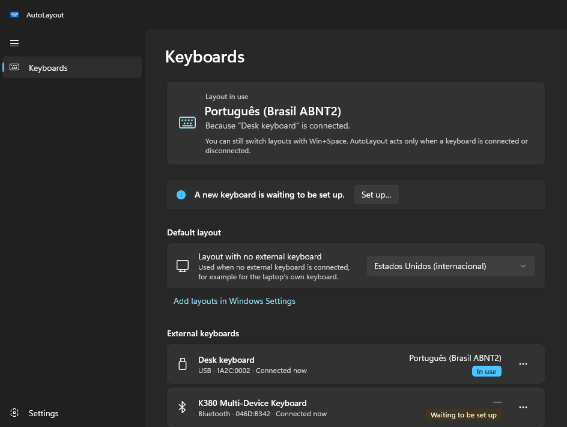
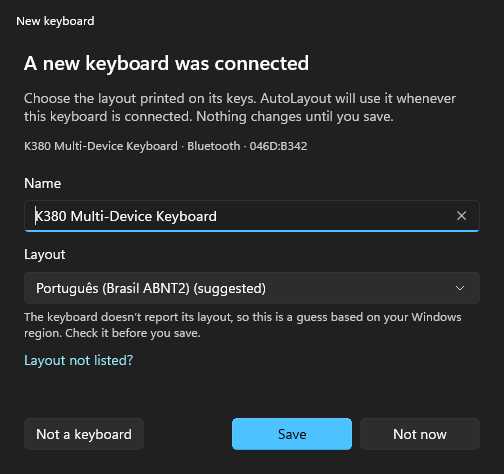
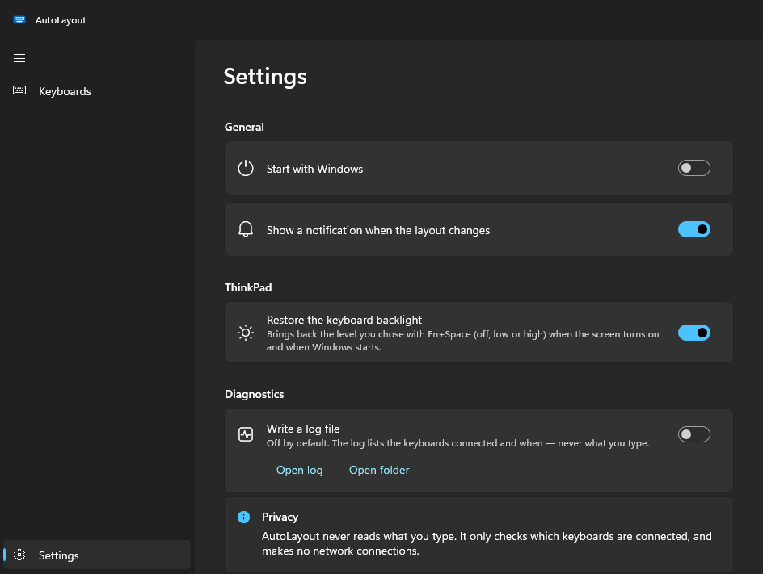

# AutoLayout

Windows has one keyboard layout at a time, not one per keyboard. If your laptop's keyboard is US-International and your desk keyboard is Brazilian ABNT2, you end up pressing Win+Space all day — and Windows switches back to its default after the lock screen anyway.

AutoLayout sits in the notification area and sets the Windows **default keyboard layout** according to the keyboards connected:

- **No external keyboard:** your default layout (for example, US-International for the laptop's keyboard).
- **An external keyboard you set up is connected:** its layout. With several, the last one connected wins.
- **A USB or Bluetooth keyboard is connected for the first time:** AutoLayout asks for its layout, with a suggestion when it can make one. Nothing changes until you answer.
- **Someone uses this PC through Remote Desktop:** Windows uses the layout of the remote computer's keyboard and AutoLayout stays out of the way (or applies a layout you choose for Remote Desktop). Back at the console, the rules above apply again.

Because it is the *default* layout that changes, new windows and the session after the lock screen get the right layout too. Win+Space still works as usual: AutoLayout only acts when a keyboard is connected or disconnected.

| Keyboards | A new keyboard | Settings |
|---|---|---|
|  |  |  |

## Privacy

**AutoLayout never reads what you type.** It does not hook, record or inject keystrokes. It lists keyboard devices (vendor and product ids and the name Windows has for them) and listens for device, session and display notifications. It needs no administrator rights, makes no network connections and has no telemetry. What it keeps, and where, is in [PRIVACY.md](PRIVACY.md).

## ThinkPad keyboard backlight

ThinkPads turn the keyboard backlight off when the screen turns off and at every start, and leave it off. On ThinkPads, AutoLayout can put back the level you chose with Fn+Space (off, low or high) when the screen turns on, after sleep and when Windows starts. Choosing "off" with Fn+Space is respected. The option only appears when Lenovo's ThinkPad power management driver is installed.

Hat tip to [SaltwaterC/KeyboardBacklightForLenovo](https://github.com/SaltwaterC/KeyboardBacklightForLenovo), which showed that Lenovo's own driver exposes the keyboard backlight to applications. AutoLayout's implementation is its own.

## Install

- **Microsoft Store:** coming soon. The Store version is signed by Microsoft and installs and updates like any Store app.
- **From source:** see [Building](#building).

## Using it

On first start the main window opens with your current default layout selected. Close it and AutoLayout keeps running in the notification area.

- **Notification area icon:** click it to open AutoLayout, or to set up a keyboard that is waiting. Right-click for the menu.
- **Keyboards:** the layout in use and why, the layout when no external keyboard is connected, and every keyboard seen, with its layout and status. From a keyboard's "…" menu you can edit it, ignore it (for mice and receivers that Windows lists as keyboards) or forget it.
- **Settings:** start with Windows, a notification when the layout changes, the ThinkPad backlight and a diagnostic log.

Settings and the log are in `%LocalAppData%\AutoLayout` (`settings.json`, `autolayout.log`). The log is off unless you turn it on, or start AutoLayout with `--log`.

### Languages

The interface follows the Windows display language and is available in 38 languages: Arabic, Bulgarian, Chinese (Simplified and Traditional), Croatian, Czech, Danish, Dutch, English, Estonian, Finnish, French (France and Canada), German, Greek, Hebrew, Hungarian, Italian, Japanese, Korean, Latvian, Lithuanian, Norwegian Bokmål, Polish, Portuguese (Brazil and Portugal), Romanian, Russian, Serbian (Latin), Slovak, Slovenian, Spanish (Spain and Mexico), Swedish, Thai, Turkish and Ukrainian.

Except for English and Brazilian Portuguese, the translations were machine-made and have not been reviewed by native speakers yet. Corrections are very welcome: each language is one file, `src/AutoLayout/Strings/<language>/Resources.resw`, and `en-US` has a comment on each string.

## Layout suggestions

Keyboards rarely say which layout they have: most vendors use the same product id for every regional version, and the HID country code is almost always zero. AutoLayout suggests a layout only from what is reliable — words in the product name such as "ABNT" or "Japanese", and Apple keyboards whose product id tells the JIS variant (ids from the Linux kernel's `hid-ids.h`) — and, as a weak guess shown only in the setup window, the layout of your Windows region. You always confirm.

## Building

Requirements:

- Windows 10 version 2004 or later, or Windows 11.
- [.NET 10 SDK](https://dotnet.microsoft.com/download) (`winget install Microsoft.DotNet.SDK.10`).
- For the Microsoft Store packages: the Visual Studio C++ build tools, which Native AOT uses to link (`winget install Microsoft.VisualStudio.BuildTools` with the "Desktop development with C++" workload, including the ARM64 tools).

In PowerShell:

```powershell
.\build.ps1          # tests, then builds src\AutoLayout\bin\Release\net10.0-windows10.0.19041.0\win-x64\AutoLayout.exe
.\build.ps1 -Store   # also the Store packages, in dist\store (x64 and ARM64)
```

The XAML compiler fails on paths longer than 260 characters; clone to a short path such as `C:\src\AutoLayout` if the build stops with `WMC9999`.

The Store build is compiled ahead of time (Native AOT) and trimmed: the package is about 4 MB, and the app starts in about a third of a second. `docs/STORE.md` walks through publishing it.

Command-line options, mostly for development:

| Option | What it does |
|---|---|
| `--background` | Start in the notification area without opening the window (used by "Start with Windows"). |
| `--log` | Write the log for this run, whatever the setting. |
| `--demo` | Sample keyboards and layouts; nothing is read from or applied to the PC. |
| `--demo --lang de-DE` | The same, in another language. |
| `--demo --capture <folder>` | Save the screenshots used in this README and exit. |

`tools\make-icon.ps1` redraws the icon and the Store images.

## License

Apache License 2.0 — see [LICENSE](LICENSE) and [NOTICE](NOTICE).
